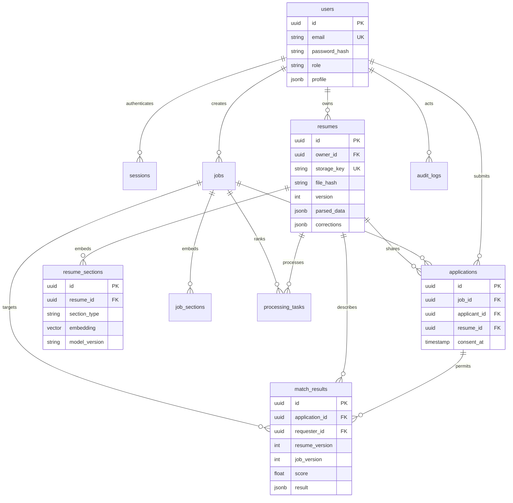

# Database schema

UUID primary keys, timestamps, cascading foreign keys, unique emails, unique applicant/job applications, JSONB parser evidence, and vector(384) section embeddings are implemented in SQLAlchemy and the fixed Alembic `0001` migration. Changing live model definitions does not silently change old migrations.

`storage_deletions` intentionally has no owner/resume FK so deletion work survives account erasure. Audit actor IDs become null when accounts are deleted. Records never contain passwords or extracted document bodies in audit actions.

Indexes cover ownership/filter relationships and job status. Job full-text search has an English GIN expression index. Vector search is exact; no HNSW/IVFFlat index is claimed to improve an unmeasured workload. The application does not support SQLite; tests use SQLite variants solely to isolate authorization/business logic.

Initial simplifications: applicant/recruiter profile attributes use `users.profile`; normalized skill vocabulary is an original versioned Python catalog; extracted skills, employment, education, projects and certifications remain evidence-bearing JSONB/narrative fields. They are not all represented as fully normalized independent tables. See limitations before presenting the schema as the complete aspirational master brief.
